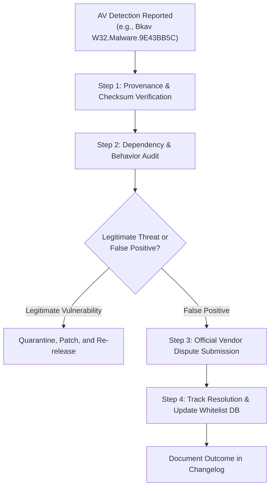

# Warm-AntiCheat — Windows Security, Antivirus Compatibility & False-Positive Prevention

This document specifies the security architecture, antivirus compatibility practices, and false-positive remediation procedures for the **Warm-AntiCheat** desktop applications (Contest Builder, Participant Client, and Judge Verifier).

---

## 1. Ethical Security Principles & Non-Malware Guarantee

Warm-AntiCheat is designed as an open-source, ethical competition integrity framework. It operates under strict engineering principles:

1. **Documented Operating System APIs Only**:
   - All process enumeration uses documented Win32 APIs (`CreateToolhelp32Snapshot`, `Process32FirstW`, `Process32NextW`).
   - Network state observation uses IP Helper APIs (`GetIfTable2`, `GetExtendedTcpTable`).
   - System lifecycle detection uses documented Windows Event and power notifications.
2. **Zero Evasion or Stealth**:
   - No DLL injection, memory hooking, code hollowing, or process tampering.
   - No hidden processes or background services without user notification.
   - No evasion techniques such as API unhooking, direct syscalls bypassing security drivers, or anti-debugging tricks designed to impede endpoint protection.
3. **No Antivirus Tampering**:
   - Warm-AntiCheat **never** attempts to disable, terminate, bypass, or add exclusion rules to Microsoft Defender, Microsoft Defender for Endpoint, or third-party antivirus/EDR software.
   - Participants and organizers are **never** instructed or requested to disable their security software.
4. **Principle of Least Privilege**:
   - Standard competition monitoring runs under normal user privileges wherever possible.
   - Administrator or root privileges are requested only when required by specific OS interfaces and with clear, upfront user disclosure.

---

## 2. Windows Defender and SmartScreen Trust Architecture

### 2.1 Authenticode Code Signing
Official production releases of Warm-AntiCheat are signed using a legitimate standard or Extended Validation (EV) Authenticode code-signing certificate.
- **Timestamping**: SHA-256 Authenticode signatures timestamped via RFC 3161 compliant timestamp authorities (e.g., DigiCert or Sectigo).
- **Embedded PE Metadata**: Executables embed detailed Windows Portable Executable (PE) Version Information resources:
  - `CompanyName`: Kasra Borjloo / Warm-AntiCheat Core Contributors
  - `FileDescription`: Warm-AntiCheat Competition Integrity Framework
  - `FileVersion` & `ProductVersion`: `0.1.0.0`
  - `LegalCopyright`: Copyright © 2026 Kasra Borjloo. Licensed under GPL-3.0.
  - `OriginalFilename`: `warm_builder_app.exe`, `warm_participant_app.exe`, `warm_judge_app.exe`
  - `ProductName`: Warm-AntiCheat

### 2.2 Unsigned Development Builds
For local development and self-compiled builds from source:
- Source code is fully auditable.
- Cryptographic SHA-256 checksums are published in `SHA256SUMS.txt`.
- Participants and developers can verify local build artifacts using `certutil -hashfile <FILE> SHA256` or `sha256sum`.

---

## 3. False-Positive Analysis & Investigation Case Studies

Antivirus scanners and machine learning heuristic engines occasionally flag newly released, unsigned, or Rust-compiled binaries due to generic heuristics (e.g., packed sections, high entropy from embedded static runtime routines, or unfamiliar compiler output).

### Case Study: Bkav Pro Detection (`W32.Malware.9E43BB5C`)

#### 1. Identification & Signal Classification
- **Vendor**: Bkav Pro / Bkav Endpoint Security.
- **Detection Name**: `W32.Malware.9E43BB5C` (or similar heuristic pattern `W32.AIDetect.<HASH>`).
- **Classification**: **Generic ML Heuristic False Positive**.
- **Root Cause**:
  - The static linking of the Rust standard library and runtime (`crt2.o`, `rust-lld`, unwinding tables).
  - Absence of prior cloud reputation (SmartScreen / Bkav Cloud reputation telemetry) on brand-new release hashes.
  - Absence of an EV digital signature on initial open-source development binaries.
  - Static embedding of security policies referencing prohibited process names (e.g., `ollama.exe`, `lmstudio.exe`), which naive heuristic tokenizers incorrectly flag as malicious strings.

#### 2. Standard Triage and Investigation Protocol
When an antivirus scanner produces a detection:

1. **Step 1: Provenance & Checksum Verification**:
   - Compare the flagged binary's SHA-256 against `SHA256SUMS.txt` published in the official GitHub Release and built by GitHub Actions CI.
   - If the checksum does not match, the file is corrupt or tampered with on the client machine; advise clean re-download.
2. **Step 2: Dependency & Behavioral Audit**:
   - Run `cargo audit` to confirm zero known CVEs in upstream dependencies.
   - Inspect build logs and confirm the binary contains no unauthorized external libraries.
   - Run static behavior analysis (PE headers, import table, strings).
3. **Step 3: Official Vendor Submission (Dispute & Whitelisting)**:
   - Submit the exact executable to the vendor's false-positive portal.
   - **Bkav False-Positive Submission**:
     - Email: `bkav@bkav.com` / `falsepositive@bkav.com`
     - Subject: `[False Positive Report] Warm-AntiCheat Open-Source Binary - W32.Malware.9E43BB5C`
     - Content: Application URL, GitHub repository, VirusTotal analysis link, exact SHA-256 hash, and clean behavioral description.
   - **Microsoft Security Intelligence (Defender)**:
     - URL: `https://www.microsoft.com/en-us/wdsi/filesubmission`
     - Submission Type: "Software Developer" -> "Incorrectly detected as malware (false positive)".
   - **VirusTotal Dispute**:
     - Request re-scan via VirusTotal monitor and submit vendor-specific dispute links.
4. **Step 4: Non-Evasion Rule**:
   - **Never** introduce junk code, packing, or binary mutation to "bypass" the scanner.
   - Maintain full transparency with security vendors until the false positive is resolved in their definitions.

---

## 4. Major Antivirus Vendor False-Positive Portals

| Vendor | Product | Submission Portal / Email |
| :--- | :--- | :--- |
| **Microsoft** | Defender / SmartScreen | [Microsoft WDSI Portal](https://www.microsoft.com/en-us/wdsi/filesubmission) |
| **Bkav** | Bkav Pro / Total Security | Email: `bkav@bkav.com` / `falsepositive@bkav.com` |
| **Avast / AVG** | Avast Antivirus | [Avast Whitelist Program](https://www.avast.com/false-positive-file-form) |
| **Bitdefender** | GravityZone / Total Security | [Bitdefender False Positive Form](https://www.bitdefender.com/consumer/support/answer/29358/) |
| **Kaspersky** | Kaspersky Endpoint Security | [Kaspersky OpenTIP](https://opentip.kaspersky.com/) |
| **Sophos** | Intercept X | [Sophos Sample Submission](https://support.sophos.com/support/s/filesubmission) |
| **CrowdStrike** | Falcon Complete | CrowdStrike False Positive dispute via customer support portal |

---

## 5. Software Bill of Materials (SBOM) & Supply Chain Integrity

1. **Automated Vulnerability Scanning**:
   - Every commit and pull request runs `cargo audit` in GitHub Actions.
   - Cargo `Cargo.lock` is committed to version control to guarantee deterministic, reproducible dependency resolution.
2. **SBOM Generation**:
   - Software Bill of Materials in SPDX and CycloneDX formats are generated during release builds (`cargo cyclonedx` / `cargo sbom`).
   - SBOMs are published alongside each GitHub Release.
3. **Hermetic CI Builds**:
   - Production binaries are built in isolated GitHub Actions runners (`windows-latest`, `ubuntu-latest`, `macos-latest`) using clean container environments.
