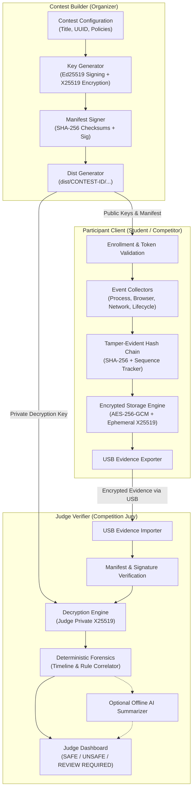

# Warm-AntiCheat Architecture

## 1. System Philosophy & Decoupled Design

Warm-AntiCheat is designed with three core architectural mandates:
1. **Zero Phone-Home Dependency**: Competitions frequently operate in isolated local networks, stadiums, or air-gapped auditoriums without stable cloud connectivity. All evidence recording, sealing, and analysis must function completely offline.
2. **Cryptographic Asymmetry**: Participants are assumed to possess administrative privileges over their devices. The architecture guarantees that no participant can forge manifests, inspect judge notes, or decrypt other competitors' submissions, because private keys are strictly retained by organizers.
3. **Evidence-Based Forensics**: The system never operates as an opaque, arbitrary ban engine. Instead, it generates an immutable, verifiable ledger of timestamped system events. Judges receive transparent, explainable timelines with full cryptographic provenance.

---

## 2. Monorepo Crate Architecture

The repository is structured as a Cargo workspace with distinct concerns:

| Crate / App | Purpose | Dependencies |
| :--- | :--- | :--- |
| `crates/core` | Core models: Contest, Participant, Session, Enrollment Tokens | serde, uuid, chrono, thiserror |
| `crates/crypto` | X25519, Ed25519, AES-256-GCM, HKDF, SHA-256, Hash Chains | dalek suites, sha2, aes-gcm |
| `crates/events` | Strongly typed audit events & JSON schema | core, serde, uuid, chrono |
| `crates/storage` | SQLite event store, sequence integrity & encrypted archive packaging | rusqlite, crypto, events |
| `crates/policies` | Security policies: prohibited process rules, restricted browser domains | core, serde |
| `crates/platform` | OS-specific collectors (Windows Win32, Linux /proc, macOS ES abstraction) | sysinfo, events, policies |
| `crates/verifier` | Forensic classifier (SAFE, UNSAFE, REVIEW REQUIRED) | crypto, events, policies, storage |
| `crates/audit` | Timeline analysis, event correlation & local LLM summarization | events, verifier |
| `crates/builder_core` | Build distributor, manifest packager & checksum validator | core, crypto, policies |
| `apps/builder` | Contest Builder desktop application UI and orchestration | builder_core, core, crypto |
| `apps/participant` | Participant Client desktop application UI, monitoring daemon | platform, storage, policies |
| `apps/judge` | Judge Verifier desktop application UI, dashboard & report reviewer | verifier, audit, storage |

---

## 3. Data Flow & Cryptographic Lifecycle

### Stage 1: Contest Generation (Contest Builder)
1. Organizer defines contest parameters: `title`, `contest_id`, `start_time`, `end_time`, `restricted_domains`, `prohibited_apps`.
2. Builder generates:
   - **Manifest Signing Key Pair** (Ed25519): `manifest_signing_key.priv` (kept by organizer) and `manifest_signing_key.pub` (embedded in client).
   - **Evidence Encryption Key Pair** (X25519): `judge_evidence_key.priv` (stored in Judge package only) and `judge_evidence_key.pub` (embedded in client).
3. Builder outputs the standardized `dist/<CONTEST_ID>/` bundle.

### Stage 2: Competition Session (Participant Client)
1. Participant launches the client and enrolls with their assigned Participant ID and Session Token.
2. The client initializes an append-only SQLite storage database.
3. Event collectors monitor:
   - Process creations, terminations, and prohibited AI runtimes (e.g., Ollama, LM Studio, llama.cpp).
   - Restricted domain web access attempts.
   - Network interface transitions (Wi-Fi SSID, Ethernet connects/disconnects).
   - System lifecycle events (sleep, wake, application shutdowns).
4. Each event is recorded into a SHA-256 hash chain:
   $$\text{Hash}_n = \text{SHA-256}(\text{Seq}_n \parallel \text{Timestamp}_n \parallel \text{Hash}_{n-1} \parallel \text{Category}_n \parallel \text{Payload}_n)$$
5. The event payload is sealed into the encrypted SQLite database using AES-256-GCM.

### Stage 3: Offline Evidence Hand-off (Removable USB / Storage)
1. At the conclusion of the contest, or upon proctor request, the Participant Client exports the encrypted audit archive.
2. The archive includes the participant ID, contest UUID, sequence manifest, encrypted event database, and file integrity checksums.
3. The package is transferred to an authorized Judge workstation.

### Stage 4: Verification & Forensic Analysis (Judge Verifier)
1. Judge selects the contest and provides the Judge Private Key (`judge_evidence_key.priv`).
2. The Verifier verifies:
   - Manifest digital signature against the organizer's public key.
   - Evidence package file hashes and checksum integrity.
   - Continuous hash-chain sequence from `Seq 0` to final event.
3. The Verifier decrypts the audit events and executes deterministic correlation rules:
   - **`SAFE`**: No prohibited processes, domain violations, or broken monitoring periods observed.
   - **`UNSAFE`**: Direct, verifiable evidence of a prohibited tool or domain access during the active contest window.
   - **`REVIEW REQUIRED`**: Missing sequence numbers, unexplained monitoring gaps, or corrupted event chains.
4. An optional local AI summarizer produces human-readable executive summaries highlighting pertinent timestamps for jury review.
