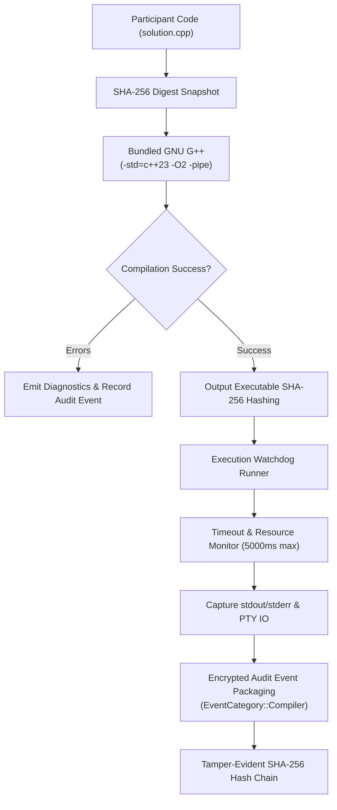

# Warm-AntiCheat — Built-in Offline C++ Compiler Guide

This guide describes the architecture, security isolation, toolchain bundling, and cryptographic audit logging for the **Built-in Offline C++ Compiler** feature of Warm-AntiCheat.

---

## 1. Architectural Mission & Zero-System-Dependency Guarantee

Traditional programming competition environments suffer from varied, broken, or mismatched local toolchain installations across participants' personal devices (different GCC versions, missing MinGW headers, incompatible Clang setups, or broken PATH configurations).

The Warm-AntiCheat Built-in C++ Compiler solves this by providing a **completely self-contained, portable GNU GCC/G++ C++23 toolchain bundled directly inside the Participant Client application distribution**.

### Strict Operational Guarantees:
1. **Zero System Compiler Fallback**:
   - The application **never** searches the system `PATH`.
   - It **never** invokes or depends on any pre-installed compiler on the machine (System GCC, MinGW, MSYS2, Clang, Visual Studio Build Tools, Homebrew).
   - If a bundled toolchain is not packaged for a particular operating system or architecture, the application explicitly reports the platform as unsupported rather than silently falling back to a system binary.
2. **Zero Modification to Host Environment**:
   - Does **not** modify the participant's persistent environment variables (`PATH`, `INCLUDE`, `LIB`).
   - Does **not** write to system registry, global directories, or `/usr/local`.
   - All compilation processes run in ephemeral, isolated execution environments where `PATH` is scoped strictly to the bundled toolchain's `bin/` directory and critical operating system libraries (`C:\Windows\System32` on Windows, `/lib` on Linux).
3. **100% Offline Capability**:
   - Requires zero internet connection.
   - All standard libraries, C++23 runtime modules, and GNU libstdc++ precompiled headers are bundled locally.
4. **Non-Overridable Signed Manifest Configuration**:
   - The contest organizer decides whether to enable the built-in compiler in the Contest Builder.
   - The setting is cryptographically sealed into `contest_manifest.json` and signed with the organizer's Ed25519 private key.
   - The participant cannot override or forge this configuration.

---

## 2. Supported Language Standards & Library Capabilities

- **Language Standard**: ISO C++23 (`-std=c++23`).
- **Standard Competitive Programming Header**: Full support for `#include <bits/stdc++.h>` through bundled GNU libstdc++ headers.
- **Optimization Flags**: Defaults to `-O2 -pipe` for fast, standardized code generation.
- **Diagnostics**: Compiler warnings and errors (from `stderr` and `stdout`) are formatted into human-readable terminal output.

---

## 3. Sandboxed Execution & Process Isolation

### Safety Rules:
1. **No Shell Execution**:
   - Compilers and compiled executables are invoked directly via `std::process::Command` without passing through shell interpreters (`cmd.exe`, `powershell.exe`, `sh`, `bash`).
   - Prevents command injection and path quoting vulnerabilities.
2. **Non-Privileged Execution**:
   - Compiled participant binaries are never executed with administrative or elevated privileges.
3. **Execution Watchdog & Resource Limits**:
   - Standard 5,000ms execution timeout protects workstation responsiveness against infinite loops (e.g., `while(true)`).
   - If the timeout is reached, the process is terminated immediately (`child.kill()`), reaped, and tagged with a `TimeoutExceeded` violation in the audit trail.
4. **Safe Temporary Workspaces**:
   - Builds and binaries reside in isolated application-controlled temporary directories (`tempfile::Builder`), preventing interference between attempts.

---

## 4. Cryptographic Audit Logging & Evidence Schema

For every compilation and execution attempt, the participant client automatically emits an encrypted audit event under `EventCategory::Compiler`:

| Audit Field | Purpose |
| :--- | :--- |
| **`timestamp`** | UTC wall-clock time of compilation attempt |
| **`contest_uuid`** | Unique contest identifier from signed manifest |
| **`session_id`** | Participant's competition session identifier |
| **`source_path`** | File path of the source code file |
| **`source_sha256`** | SHA-256 cryptographic digest of the source code |
| **`source_snapshot`** | Exact verbatim snapshot of the source code compiled |
| **`compiler_version`** | Exact version string of bundled compiler (e.g. GNU G++ 16.2.0) |
| **`toolchain_hash`** | SHA-256 hash of the bundled compiler binary |
| **`compilation_args`** | Full vector of flags passed (`["-std=c++23", "-O2", "-pipe", ...]`) |
| **`compilation_start` / `end`** | High-resolution timestamps of build duration |
| **`compiler_exit_code`** | Numerical exit code from `g++` |
| **`compiler_diagnostics`** | Complete compiler stderr/stdout text |
| **`output_executable_hash`** | SHA-256 hash of the resulting binary (if successful) |
| **`execution_started`** | Boolean indicating if execution was launched |
| **`execution_start` / `end`** | High-resolution runtime timing |
| **`program_exit_code`** | Return code from the user program |
| **`resource_violations`** | E.g. `TimeoutExceeded: 5000ms` |
| **`executable_args`** | Command-line arguments passed to user program |

All compiler event records are sealed using the Judge's X25519 public key via AES-256-GCM and incorporated into the SHA-256 hash chain.

---

## 5. Judge Verifier Forensics

In the offline Judge Verifier application (`apps/judge`), jury members can:
1. **Chronological Attempt Review**: View all C++ solution attempts chronologically.
2. **Verbatim Code Inspection**: Read the exact source snapshot that produced each run.
3. **Execution Diagnostics**: Review compiler errors and runtime exceptions.
4. **Binary Provenance**: Match executable SHA-256 hashes against memory and process launch records.
5. **Report Export**: Generate a Markdown/JSON audit report for dispute resolution.

> [!NOTE]
> The absence of built-in compiler events in a participant's log is **not** evidence of foul play; contestants are free to write code in external IDEs if permitted by contest policy.
